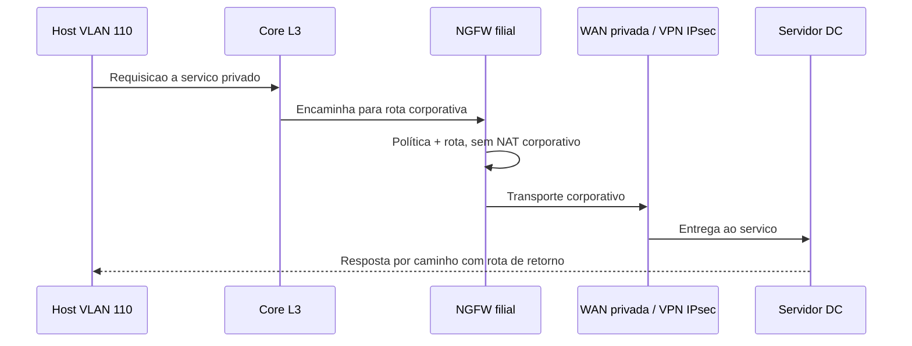
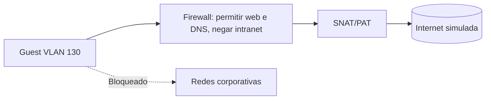
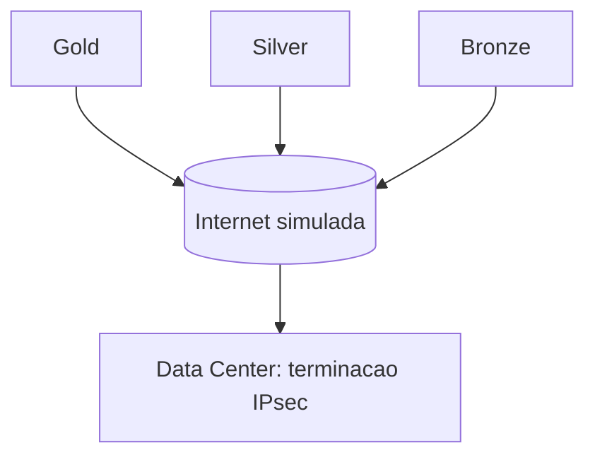
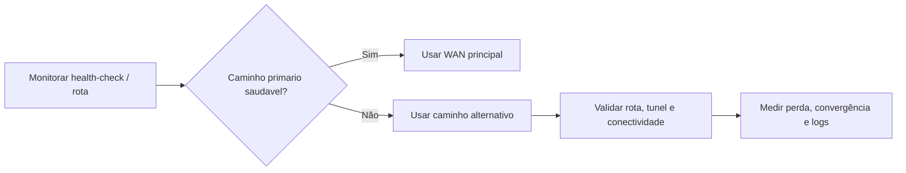

# Fluxos de tráfego | Design e testes planejados

Os diagramas a seguir são **fluxos esperados**, não capturas de pacotes nem logs já coletados.

## 1. Usuario corporativo -> Data Center

**Aceite:** caminho de ida e retorno conhecido, servidor responde, origem preservada, políticas registradas. Não inferir que OSPF esteja ativo em todos os sites.

## 2. Wi-Fi de convidados -> Internet

**Aceite:** navegacao prevista funciona e acesso a sub-redes corporativas falha por política; coletar log de bloqueio.

## 3. IPsec hub-and-spoke

**Aceite:** SAs IKE/Child SA negociadas, tráfego cifrado no underlay, contadores RX/TX aumentam, espelhamento de rotas/seletores e NTP conferidos.

## 4. Falha no caminho primario

**Aceite:** retorno previsivel e medicao real da interrupcao; não prometer failover < 10s sem medir. Sessoes existentes podem cair durante troca de WAN/NAT.
