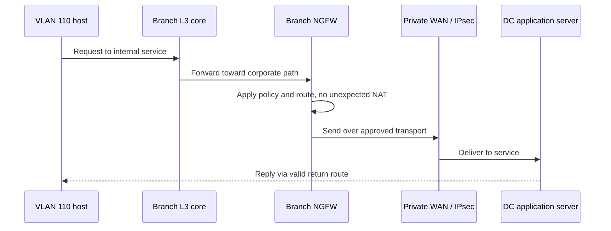
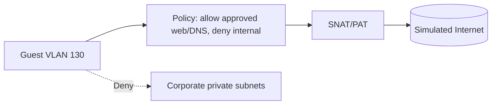
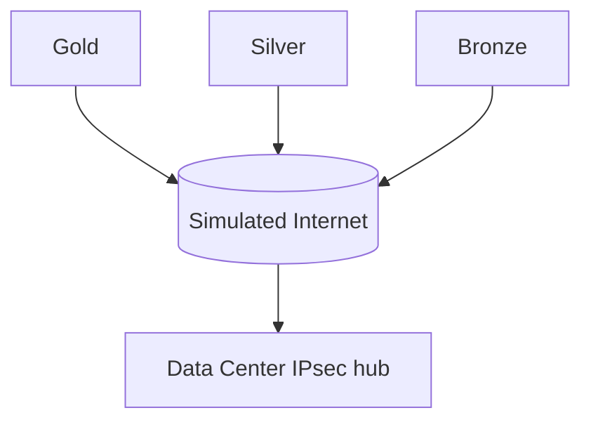
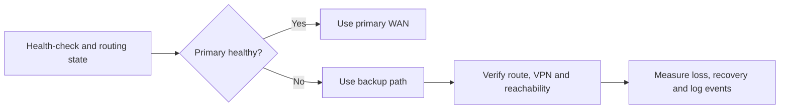

# Traffic flows | Proposed designs and test criteria

**Languages:** [Português](README.MD) | [English](README.en.md)

These diagrams depict **expected behavior**, not packet captures or evidence that services are currently running.

## 1. Corporate endpoint to Data Center

**Acceptance:** verified forward/return routing, service response, unchanged corporate source IP unless documented otherwise, and relevant policy logs. Do not assume OSPF is active at every branch.

## 2. Guest Wi-Fi to Internet

**Acceptance:** approved web/DNS behavior works after NAT is implemented, and private subnet traffic is denied with correlated logs. **The M1 LAN-only lab does not implement Internet/NAT.**

## 3. Hub-and-spoke IPsec

**Acceptance:** verified IKE/Child SAs, encryption on underlay, rising tunnel TX/RX counters, and compatible selectors/routes and system clocks.

## 4. Primary WAN failure

**Acceptance:** correct forward/return paths and measured interruption duration. Do not promise sub-10-second failover without measurement; session resets may occur during WAN/NAT transition.
