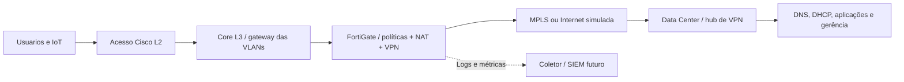

# HLD | High Level Design

**Idiomas:** [Português](README.MD) | [English](README.en.md)

## Contexto

O estudo acadêmico modela uma cooperativa de crédito fictícia com 30 agências e expectativa de expansao até 70. O escopo deste repositório comeca pela representação de **um Data Center e tres classes de filiais**; não tenta simular 70 ambientes simultaneamente.

## Diagrama de alto nivel

O desenho e **lógico e genérico**. No Bronze, o firewall pode atuar como gateway VLAN, eliminando o core L3 dedicado. Em Gold, o desenho expande para cores e firewalls redundantes.

## Principios

- **Segmentação:** VLANs padronizadas por função, filtragem explicita entre zonas e bloqueio por padrão.
- **Resiliencia proporcional:** maior disponibilidade no Gold; Silver economiza complexidade; Bronze reconhece pontos únicos de falha.
- **Roteamento controlado:** WAN privada como caminho principal Gold/Silver, VPN IPsec como alternativa; não se assume que MPLS criptografa o tráfego.
- **Observabilidade:** NTP, syslog, SNMPv3, coleta de metricas e teste de eventos em fase posterior.
- **Segurança de gestão:** SSH/HTTPS apenas em interfaces e origens administrativas autorizadas, credenciais fora do Git.
- **Reprodutibilidade:** configurações somente após escolha de imagens/versões e testes; evidências sanitizadas.

## Variantes

| Perfil | LAN | Perímetro | WAN | Risco assumido |
| --- | --- | --- | --- | --- |
| Gold | 2 cores L3, acesso redundante | Cluster NGFW HA planejado | MPLS e Internet/VPN | Dependência de serviços centralizados |
| Silver | 1 core L3 | Firewall único no baseline; HA opcional | MPLS e Internet/VPN | Core/firewall único |
| Bronze | 1 switch | Firewall único | Internet/VPN; segundo link previsto | Sem HA interna |

As variacoes Silver+ e SD-WAN completo ficam fora do marco inicial até serem documentadas e validadas.

## Premissas e limites

- Recurso **planejado** não e recurso **operacional**. HA, NAC, SIEM, QoS e VPN ainda carecem de comprovação.
- O hipervisor e as imagens de equipamentos devem suportar as funcionalidades antes de serem incluidas no escopo executado.
- Diferentes desenhos do LLD e do Plano de Implementação exigem normalizacao; [ver ADRs](../DECISIONS.md).
- O ambiente e exclusivamente de laboratório, sem túnel para redes reais nem dados de clientes.

[Voltar ao Enterprise-1](../README.MD)
