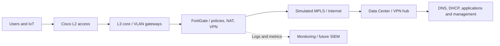

# HLD | High Level Design

**Languages:** [Português](README.MD) | [English](README.en.md)

## Context and scope

The academic case models a fictional credit union with 30 branches and a possible expansion to 70. This portfolio models only **one Data Center and three branch classes** (Gold, Silver and Bronze), not 70 operational networks.

## High-level design

This is a **logical proposal**, not a verified topology. On Bronze sites, the firewall may provide VLAN gateways instead of an L3 core. The Gold design expands to redundant L3 cores and firewall HA.

## Engineering principles

- **Segmentation:** VLANs by function, explicit zone policies and default-deny where supported.
- **Proportional resiliency:** higher availability for Gold, selective redundancy for Silver and documented single points of failure for Bronze.
- **Controlled routing:** private WAN as primary transport for Gold/Silver and IPsec backup; **MPLS is not inherently encrypted**.
- **Observability:** NTP, syslog, SNMPv3, metric collection and event simulation in later phases.
- **Secure management:** restrict SSH/HTTPS to administrative sources and interfaces; no secrets in version control.
- **Reproducible tests:** collect actual image/software versions, commands, results and sanitized evidence.

## Site variants

| Tier | Proposed LAN | Perimeter | WAN | Accepted risk |
| --- | --- | --- | --- | --- |
| Gold | Dual L3 core and redundant access | Planned NGFW HA | Private WAN + Internet/IPsec | Central service dependencies |
| Silver | Single L3 core | Single firewall baseline; optional HA | Private WAN + Internet/IPsec | Single core/firewall |
| Bronze | Single switch | Single firewall | Internet/IPsec; secondary path proposed | No internal HA |

Silver+ and comprehensive SD-WAN remain future design alternatives until separately documented and tested.

## Dependencies and open decisions

Define the effective L3 policy enforcement point, return routes, real interface inventory, platform compatibility and IPsec transport before moving to production-like config templates. See the [decisions register](../DECISIONS.en.md), [LLD](../LLD/README.en.md) and [M1 guide](../labs/M1-GOLD-LAN/README.en.md).
