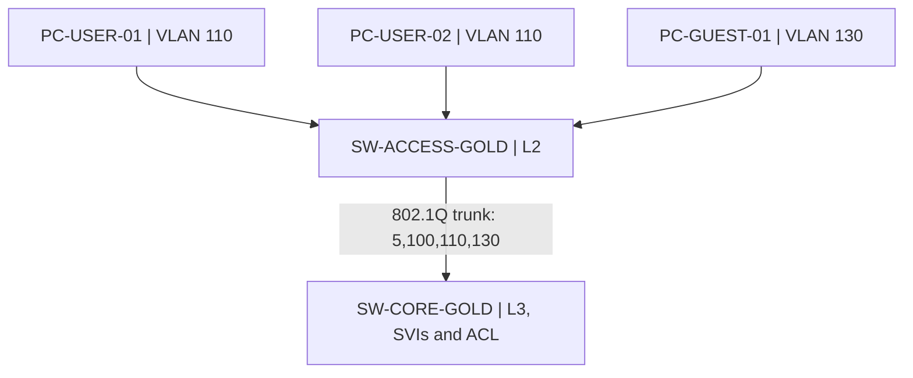

# M1 | Gold branch: VLANs, gateways and guest isolation

**Languages:** [Português](README.md) | [English](README.en.md) | [Lab index](../README.en.md)

**Status:** `planned` | **Execution:** not performed in this release | **Goal:** validate a minimal Gold branch LAN before introducing firewalls, the Data Center, OSPF, HSRP or VPNs.

## 1. Scenario

A branch needs corporate, guest and management network zones. An L2 access switch carries the VLANs to an L3 core, which hosts the gateways and performs inter-VLAN routing. The first security control is a **demonstration ACL applied inbound on the Guest SVI**. This does not replace stateful NGFW policies.

## 2. Objectives and boundaries

- Define VLANs 5 (unused native), 100 (management), 110 (users) and 130 (guests).
- Configure access ports, an 802.1Q trunk, and SVIs for VLANs 110 and 130.
- Verify positive connectivity inside VLAN 110 and to the Guest gateway.
- Deny guest-originated traffic to RFC1918 private networks, with an explicit ICMP exception to the Guest gateway itself.
- Capture *observed* outcomes, including failures and security gaps.

**Not included in M1:** NAT, actual Internet connectivity, FortiGate, DHCP, AAA, HA, intersite routing, HSRP or full two-way segmentation. A stateless ACL offers no session inspection. VLAN 100 is reserved but has no SVI or administrative access in this minimal example.

## 3. Lab topology



**There is no WAN or Internet link in this phase.** The complete Gold architecture, including HA and WAN, remains a [conceptual design](../../Topology/Gold%20site/README.en.md).

## 4. Platform and port mapping

The examples use **Cisco IOS reference syntax** with `Ethernet0/x` interface names. SVI/routing support, trunk commands, IOSvL2/IOSvL3 behavior, interface naming and ACL semantics **depend on the actual image and version**. Adapt and record those details before running the lab.

| Device | Example port | Connection | Role |
| --- | --- | --- | --- |
| SW-CORE-GOLD | Ethernet0/0 | SW-ACCESS-GOLD Ethernet0/0 | Trunk |
| SW-ACCESS-GOLD | Ethernet0/1 | PC-USER-01 | Access 110 |
| SW-ACCESS-GOLD | Ethernet0/2 | PC-USER-02 | Access 110 |
| SW-ACCESS-GOLD | Ethernet0/3 | PC-GUEST-01 | Access 130 |

## 5. Address plan

| Endpoint | VLAN | IPv4 | Gateway | Status |
| --- | ---: | --- | --- | --- |
| Core Users SVI | 110 | `10.10.10.1/24` | Local routing | Proposed |
| PC-USER-01 | 110 | `10.10.10.50/24` | `10.10.10.1` | Proposed |
| PC-USER-02 | 110 | `10.10.10.60/24` | `10.10.10.1` | Proposed |
| Core Guest SVI | 130 | `10.10.30.1/24` | Local routing | Proposed |
| PC-GUEST-01 | 130 | `10.10.30.50/24` | `10.10.30.1` | Proposed |
| VLAN 100 | 100 | Reserved (`10.10.0.0/24`) | Not configured in M1 | Planned |

These ranges match the [synthetic inventory](../../inventory/sites.json) and are not production IPs.

## 6. Unverified configuration examples

These files are **starting templates, not collected device running-configs**:

- [SW-ACCESS-GOLD.example.cfg](configs/SW-ACCESS-GOLD.example.cfg): access ports, trunk, PortFast and BPDU Guard on end-device ports.
- [SW-CORE-GOLD.example.cfg](configs/SW-CORE-GOLD.example.cfg): VLANs, SVIs, L3 routing and an inbound Guest ACL.

Example VPCS setup after adapting virtual interfaces:

```text
PC-USER-01> ip 10.10.10.50/24 10.10.10.1
PC-USER-02> ip 10.10.10.60/24 10.10.10.1
PC-GUEST-01> ip 10.10.30.50/24 10.10.30.1
```

**Important limitation:** the ACL only protects the direction `guest -> private networks` on SVI 130; an ICMP exception allows reaching that gateway address. It does not imply that user-to-guest traffic is denied or that the control plane is fully protected. Final segmentation must be re-evaluated at the actual routing/NGFW enforcement point, including two-way tests.

## 7. Verification plan

**Access switch:**

```text
show vlan brief
show interfaces trunk
show mac address-table
show spanning-tree
```

**Core (image-dependent):**

```text
show ip interface brief
show ip route connected
show access-lists GUEST-IN
show interfaces trunk
```

| ID | Procedure | Expected | Observed |
| --- | --- | --- | --- |
| M1-T01 | PC-USER-01 -> `ping 10.10.10.1` | Gateway replies | **Pending** |
| M1-T02 | PC-USER-01 -> `ping 10.10.10.60` | PC-USER-02 replies | **Pending** |
| M1-T03 | PC-GUEST-01 -> `ping 10.10.30.1` | Guest SVI replies (ACL exception) | **Pending** |
| M1-T04 | PC-GUEST-01 -> `ping 10.10.10.50` | **Denied** | **Pending** |
| M1-T05 | Core -> `show access-lists GUEST-IN` after T04 | Deny match counter increases if supported | **Pending** |
| M1-T06 | Core -> `show ip interface brief` | Expected SVIs up/up if L2 is active | **Pending** |

**Acceptance:** record original output and analysis for M1-T01 through T06. Do not mark M1 complete without evidence. A user-to-user ping in one VLAN does not exercise the ACL; guest-to-user is the negative test.

## 8. Packet analysis and evidence

Use Wireshark on the trunk or a relevant network segment, as supported by the lab platform. Examine 802.1Q tags when visible, ARP and ICMP. **A missing ICMP reply alone does not prove the ACL blocked the packet**; correlate with deny counters/logs, ARP, routes and interface state. **No real capture is included yet.**

Fill in [RESULTS.template.en.md](RESULTS.template.en.md) after execution, with date, software versions, commands and sanitized screenshots or PCAPs.

## 9. Troubleshooting

| Symptom | Initial hypothesis | Checks |
| --- | --- | --- |
| Client cannot reach gateway | Incorrect VLAN, missing trunk VLAN, interface down | `show vlan brief`, `show interfaces trunk`, `show ip interface brief` |
| SVI down | No operational L2 port for the VLAN | Access ports, trunk, VLAN state |
| Guest reaches corporate host | ACL not applied, wrong direction, alternate path | `show ip interface`, `show access-lists`, route/topology |
| Guest cannot ping gateway | Missing/out-of-order ICMP exception | ACL ordering and match counters |
| Device rejects a command | Different image/software feature set | `show version`, vendor documentation |

## 10. Conclusion and next steps

**No test conclusion yet:** this is an **adaptable lab procedure**, not a completed implementation report. Once M1 is validated, connect Gold -> firewall -> DC, settle the actual enforcement points, compare ACL versus NGFW, then implement OSPF and WAN failure scenarios.

[LLD](../../LLD/README.en.md) | [Implementation plan](../../Implementation/README.en.md) | [Evidence guidelines](../../evidence/README.en.md)
