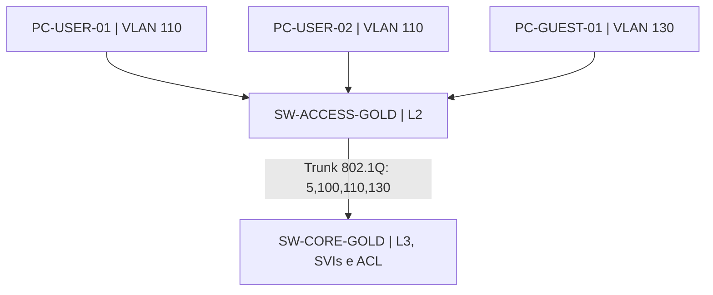

# M1 | Filial Gold: VLANs, gateways e isolamento de convidados

**Idiomas:** [Português](README.md) | [English](README.en.md) | [Índice de laboratórios](../README.md)

**Estado:** `planejado` | **Execução:** não realizada nesta versão | **Objetivo:** validar a LAN mínima da filial Gold antes de adicionar firewall, Data Center, OSPF, HSRP ou VPN.

## 1. Cenário

Uma filial precisa de rede corporativa, rede de convidados e uma zona de gerenciamento isolada. Um switch de acesso transporta as VLANs até um core L3, responsável pelos gateways e pelo roteamento inter-VLAN. O primeiro controle de segurança é uma **ACL de demonstração no SVI Guest**. O modelo não substitui políticas stateful de um NGFW.

## 2. Objetivos e limites

- Criar VLANs 5 (nativa sem hosts), 100 (management), 110 (users) e 130 (guest).
- Configurar portas access, trunk 802.1Q e SVIs de VLAN 110 e 130.
- Verificar conectividade positiva na VLAN 110 e conectividade ao gateway Guest.
- Negar tráfego originado de convidados para redes privadas RFC1918, com exceção específica para ICMP ao próprio gateway Guest.
- Registrar resultados *observados*, inclusive falhas e lacunas de segurança.

**Fora do escopo M1:** NAT, acesso real à Internet, firewall FortiGate, DHCP, AAA, HA, roteamento intersite, HSRP e isolamento bidirecional completo. ACL simples não oferece inspeção de estado. A VLAN 100 é reservada, mas não recebe SVI nem acesso administrativo neste exemplo mínimo.

## 3. Topologia de laboratório



**Não há conexão WAN/Internet nesta etapa.** A topologia Gold completa, com HA e conectividade externa, contínua sendo [arquitetura conceitual](../../Topology/Gold%20site/README.md).

## 4. Plataforma e mapeamento de portas

O exemplo usa **sintaxe de referência Cisco IOS** e nomes de interfaces `Ethernet0/x`. O suporte a SVI/roteamento, comandos de trunk, IOSvL2/IOSvL3, nomenclatura e comportamento da ACL **dependem da imagem e versão escolhidas**. Adapte e registre as imagens reais antes de executar.

| Dispositivo | Porta exemplo | Conexão | Função |
| --- | --- | --- | --- |
| SW-CORE-GOLD | Ethernet0/0 | SW-ACCESS-GOLD Ethernet0/0 | Trunk |
| SW-ACCESS-GOLD | Ethernet0/1 | PC-USER-01 | Access 110 |
| SW-ACCESS-GOLD | Ethernet0/2 | PC-USER-02 | Access 110 |
| SW-ACCESS-GOLD | Ethernet0/3 | PC-GUEST-01 | Access 130 |

## 5. Endereçamento da fase

| Endpoint | VLAN | IPv4 | Gateway | Situação |
| --- | ---: | --- | --- | --- |
| SVI Users, core | 110 | `10.10.10.1/24` | Roteamento local | Proposto |
| PC-USER-01 | 110 | `10.10.10.50/24` | `10.10.10.1` | Proposto |
| PC-USER-02 | 110 | `10.10.10.60/24` | `10.10.10.1` | Proposto |
| SVI Guest, core | 130 | `10.10.30.1/24` | Roteamento local | Proposto |
| PC-GUEST-01 | 130 | `10.10.30.50/24` | `10.10.30.1` | Proposto |
| VLAN 100 | 100 | Reservada (`10.10.0.0/24`) | Não configurado no M1 | Planejado |

Os intervalos seguem o [inventário sintético](../../inventory/sites.json); não são endereços de produção.

## 6. Configurações-modelo, ainda não validadas

Os arquivos são pontos de partida, **não são `running-configs` coletados de dispositivos**:

- [SW-ACCESS-GOLD.example.cfg](configs/SW-ACCESS-GOLD.example.cfg): portas access, trunk, PortFast/BPDU Guard em portas de usuário.
- [SW-CORE-GOLD.example.cfg](configs/SW-CORE-GOLD.example.cfg): VLANs, SVIs, roteamento L3, ACL de entrada na VLAN Guest.

Para VPCS, após adaptar as portas:

```text
PC-USER-01> ip 10.10.10.50/24 10.10.10.1
PC-USER-02> ip 10.10.10.60/24 10.10.10.1
PC-GUEST-01> ip 10.10.30.50/24 10.10.30.1
```

**Risco a observar:** esta ACL protege apenas o sentido `guest -> redes privadas` no SVI 130, e a exceção ICMP permite chegar ao endereço do gateway Guest. Não pressupõe que o tráfego de usuários para Guest seja negado, nem resolve filtragem no plano de controle. No projeto final, a política precisa ser revista no NGFW/ponto real de roteamento, com testes bidirecionais.

## 7. Plano de verificação

**Comandos de diagnóstico no switch de acesso:**

```text
show vlan brief
show interfaces trunk
show mac address-table
show spanning-tree
```

**Comandos no core (dependentes da imagem):**

```text
show ip interface brief
show ip route connected
show access-lists GUEST-IN
show interfaces trunk
```

| ID | Procedimento | Resultado esperado | Observado |
| --- | --- | --- | --- |
| M1-T01 | PC-USER-01 -> `ping 10.10.10.1` | Resposta do gateway | **Pendente** |
| M1-T02 | PC-USER-01 -> `ping 10.10.10.60` | Resposta de PC-USER-02 | **Pendente** |
| M1-T03 | PC-GUEST-01 -> `ping 10.10.30.1` | Resposta da SVI Guest (exceção ACL) | **Pendente** |
| M1-T04 | PC-GUEST-01 -> `ping 10.10.10.50` | **Bloqueado** | **Pendente** |
| M1-T05 | Core -> `show access-lists GUEST-IN` após M1-T04 | Incremento no contador de deny, se suportado | **Pendente** |
| M1-T06 | Core -> `show ip interface brief` | SVIs esperadas em estado up/up, se L2 permitir | **Pendente** |

**Critério de aceite:** registrar saída bruta e análise de M1-T01 a T06; não marcar M1 como concluído sem comprovação. O ping entre hosts na mesma VLAN não testa a ACL; a tentativa de Guest para Users é o caso negativo específico.

## 8. Captura de tráfego e evidências

Use Wireshark no enlace do trunk ou no caminho de teste, conforme capacidade da plataforma. Analise marcação 802.1Q quando visível, ARP e ICMP. A ausência de resposta ICMP **isoladamente não prova que a ACL foi a causa**; correlacione com contador/log, ARP, rota e estado das interfaces. **Ainda não há captura real neste repositório.**

Preencha [RESULTS.template.md](RESULTS.template.md) depois da execução, com data, versões, comandos e prints sanitizados. Armazene screenshots e PCAP apenas quando estiverem livres de dados sensíveis.

## 9. Troubleshooting

| Sintoma | Hipótese inicial | Verificações |
| --- | --- | --- |
| PC não acessa o gateway | VLAN incorreta, trunk sem VLAN, interface down | `show vlan brief`, `show interfaces trunk`, `show ip interface brief` |
| SVI em down | Não há porta L2 operacional na VLAN | `show vlan brief`, portas access e trunk |
| Guest alcança usuário | ACL não aplicada, direção incorreta, encaminhamento alternativo | `show ip interface`, `show access-lists`, rota e topologia |
| Guest não pinga seu gateway | Exceção ICMP ausente/fora de ordem | Sequência da ACL e contador de matches |
| Switch não aceita comando | Diferença de imagem/versão | `show version`, capacidades da plataforma |

## 10. Conclusão e próximos passos

**Conclusão ainda não disponível:** este documento é um **roteiro executável a adaptar**, não o relato de um laboratório concluído. Após validar M1, criar a conexão Gold -> firewall -> DC, definir pontos de filtragem, comparar ACL e NGFW, depois avançar para OSPF e falha de WAN.

[LLD](../../LLD/README.MD) | [Plano de implementação](../../Implementation/README.MD) | [Padrão de evidências](../../evidence/README.md)
