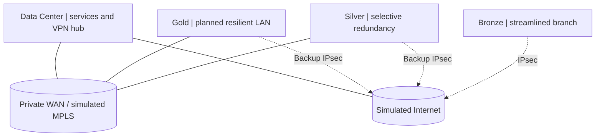

# Enterprise Networking | Personal architecture and lab portfolio

**Languages:** [Português](README.md) | [English](README.en.md)

A personal project by **Giovani Serra** focused on progressively designing, implementing and verifying a virtual multi-site enterprise network. Its purpose is to document **engineering decisions, configurations, traffic flows, failures, tests and evidence**, as an integrated network engineering case study rather than a collection of diagrams.

> **Implementation transparency:** the HLD, LLD and sample inventory are documented. The Python validator and unit tests run locally; remote CI execution must still be verified on GitHub. **No evidence has been published that the enterprise topology, IPsec VPN, HA or security policies are operational.** Example configurations are explicitly unverified templates.


## Business scenario

The original academic case describes a **fictional credit union** with 30 branches and projected expansion to 70. The lab covers only four representative roles: **Data Center, Gold, Silver and Bronze**, allowing the architecture to be tested at a manageable scale.

| Domain | Responsibility | Technologies in the design | Status |
| --- | --- | --- | --- |
| Data Center | Services, central routing and VPN hub | Core, FortiGate, DNS/DHCP, monitoring | Planned |
| Gold | High-criticality branch | VLANs, L3, OSPF, HA, dual WAN | Planned |
| Silver | Mid-sized branch | L3, static routes, backup connectivity | Planned |
| Bronze | Small branch | Switch, NGFW, VPN access | Planned |

> **Status key:** `planned` = documented intent; `in progress` = deployment/testing underway; `validated` = configuration plus real test evidence available. Nothing here implies production deployment.

## Logical architecture



These links describe **proposed paths**, not verified routing adjacencies or live tunnels. OSPF, IPsec, access control and failover will each require distinct acceptance tests.

## Labs and documentation

| Deliverable | Contents | Link |
| --- | --- | --- |
| Integrated case study | Site roles, requirements and navigation | [Enterprise-1](Enterprise-1/README.en.md) |
| High Level Design | Domains, dependencies and trade-offs | [HLD](Enterprise-1/HLD/README.en.md) |
| Low Level Design | VLANs, addressing and routing | [LLD](Enterprise-1/LLD/README.en.md) |
| Topologies | Gold, Silver, Silver+ and Bronze | [Gallery](Enterprise-1/Topology/README.en.md) |
| **Lab M1: Gold LAN** | Scope, diagram, inventory, example configs, verification and troubleshooting | [Open lab](Enterprise-1/labs/M1-GOLD-LAN/README.en.md) |
| Implementation plan | Phases, acceptance, rollback and risks | [Implementation](Enterprise-1/Implementation/README.en.md) |
| Security | Proposed controls and test matrix | [Security](Enterprise-1/SECURITY.en.md) |
| Troubleshooting | Hypotheses, commands and analysis | [Scenarios](Enterprise-1/Troubleshooting/README.en.md) |
| Evidence | How to capture actual observations | [Guidelines](Enterprise-1/evidence/README.en.md) |
| Roadmap | Milestones and definitions of done | [Roadmap](Enterprise-1/ROADMAP.en.md) |

### Standard lab write-up

Each lab will include **scenario, objectives, topology, environment and software versions, addressing plan, sanitized configuration, verification commands, expected versus observed results, packet captures/screenshots, troubleshooting, limitations and conclusions**. Only executed tests with evidence will be marked as validated.

## Tools and technologies

- **Planned virtual environment:** EVE-NG, Cisco IOS/IOS-XE and virtual switches, FortiGate, Windows/Linux and Wireshark. Specific images and versions will be recorded when verified.
- **Topics in scope:** VLANs, 802.1Q trunks, STP, L3 routing, OSPF, HSRP, IPsec, NAT, ACLs/NGFW policies, syslog, SNMPv3 and Python automation.
- **Currently delivered:** synthetic JSON inventory, Python validator and unit tests. These are not network connectivity tests.

### Run local checks

Requires **Python 3.10+**; standard library only.

```bash
python scripts/validate_inventory.py
python -m unittest discover -s tests -v
python scripts/render_inventory.py
```

[Synthetic inventory](Enterprise-1/inventory/sites.json) | [Implementation and acceptance tests](Enterprise-1/Implementation/README.en.md) | [Security policy](Enterprise-1/SECURITY.en.md)

## Next implementation

The first module, **M1: Gold branch LAN segmentation**, contains example configurations for an access switch, L3 core and test hosts. It is **not executed in this repository**. Next: map ports to actual images, run it in EVE-NG and attach the collected outputs and analysis.

## Ownership and usage

**© 2026 Giovani Serra.** This is a **personal portfolio**, not a collaborative project. **External contributions, pull requests and feature requests are not accepted.** Content is publicly visible for reference and demonstration only. No open-source license is granted for my original files. Third-party product, image and documentation rights remain with their owners. See [Project policy](PERSONAL_PROJECT.en.md).

**Security note:** never commit credentials, pre-shared keys, production data, licenses or sensitive device outputs. The original academic reports are not included in this repository.
