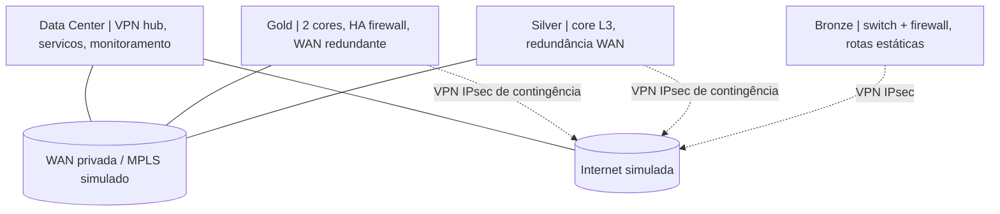

# Enterprise Network | Multi-Site Infrastructure & Security Lab

**Laboratório de engenharia de redes corporativas, segurança e operações.** Projeto de portfolio baseado no PIF e no Low Level Design da pós-graduação em Redes e Ciberseguranca (2026), adaptado para implementação incremental em **EVE-NG**.

> **Estado atual:** arquitetura documentada e inventario de exemplo validado automaticamente. **Não ha, neste repositorio, evidências de que os sites, tuneis, redundância ou mecanismos de segurança estejam operacionais.** Os testes de laboratório serão publicados a medida que forem executados.

[Arquitetura](Enterprise-1/HLD/README.MD) · [LLD e VLANs](Enterprise-1/LLD/README.MD) · [Plano de implementação](Enterprise-1/Implementation/README.MD) · [Topologias](Enterprise-1/Topology/README.MD) · [Roadmap](Enterprise-1/ROADMAP.md) · [Validação](Enterprise-1/evidence/README.md)

## Business case

Uma cooperativa de crédito fictícia com **30 agências**, com expansao planejada para **70 sites**, precisa conectar um Data Center central a unidades de portes distintos. O design privilegia **segmentacao, segurança perimetral, redundância proporcional a criticidade, continuidade operacional e observabilidade**.

O laboratório representa um recorte com quatro domínios: **Data Center**, **Gold**, **Silver** e **Bronze**. O modelo **Silver+** aparece como variante visual exploratoria, mas não integra o escopo básico de implementação.

## Arquitetura proposta



**Premissas:** Gold usa roteamento dinâmico e conectividade WAN redundante; Silver utiliza rotas estáticas como baseline e pode evoluir para OSPF; Bronze permanece com roteamento estático. O roteamento detalhado e os caminhos de contingencia precisam ser comprovados por testes, não apenas pelo diagrama.

## Entregas no repositorio

| Area | Entrega | Situacao |
| --- | --- | --- |
| Design | HLD, LLD, matriz de VLANs, topologias e ADRs | Documentado, sujeito a revisão |
| Planejamento | Etapas, criterios de aceite, rollback e testes | Documentado |
| Inventario | Exemplo de sites, redes e validação com Python | **Script executavel / testes locais** |
| Laboratório | Configuracoes Cisco/FortiGate e arquivos EVE-NG | Pendente |
| Segurança | Politicas inter-VLAN, VPN, NAC e logs | Projetado; não validado |
| Operacao | Evidencias de failover, incidentes e monitoramento | Pendente |

## Projetos e documentos

- **[Enterprise-1](Enterprise-1/README.MD)**: arquitetura multi-site e trilha principal.
- [HLD](Enterprise-1/HLD/README.MD): contexto, componentes, fluxos e riscos.
- [LLD](Enterprise-1/LLD/README.MD): padrão IPv4, VLANs, interfaces e premissas de roteamento.
- [Topologias](Enterprise-1/Topology/README.MD): imagens originais dos sites e contexto.
- [Fluxos](Enterprise-1/FLOW/README.MD): LAN, Internet, IPsec e failover.
- [Segurança](Enterprise-1/SECURITY.md): controles e políticas previstas.
- [Troubleshooting](Enterprise-1/Troubleshooting/README.MD): cenários de investigacao.
- [Roadmap](Enterprise-1/ROADMAP.md): evolução por marcos e critérios de conclusão.
- [Fontes e rastreabilidade](Enterprise-1/SOURCES.md): relação com os documentos do PIF.

As pastas `Hybrid-Cloud-Network`, `ISP-Network-Simulation` e `Network-Security-Monitoring-Lab` são **frentes futuras** e não representam implementacoes entregues.

## Demonstracao executavel (fase de fundacao)

Requer apenas **Python 3.10+**, sem dependências de terceiros:

```bash
python scripts/validate_inventory.py
python -m unittest discover -s tests -v
python scripts/render_inventory.py
```

O inventario em [`Enterprise-1/inventory/sites.json`](Enterprise-1/inventory/sites.json) contem dados **fictícios e ilustrativos**; não representa endereços de uma empresa real nem prova de configuração dos appliances.

## Como acompanhar a evolucao

Cada fase passa de **planejada** para **validada** apenas quando houver: configuração versionada, descrição do cenário, comando ou teste reproduzivel, resultado observado, evidências sanitizadas e limitacoes registradas. Consulte [criterios de aceite](Enterprise-1/Implementation/README.MD) e [padrão de evidências](Enterprise-1/evidence/README.md).

## Autoria, escopo e segurança

Projeto de **Giovani Serra**. Documentação técnica construida a partir do PIF academico do autor; as topologias são modelos conceituais, não representacoes de rede produtiva. **Não publicar** chaves VPN, senhas, tokens, `running-config` com segredos, IPs reais ou dados de clientes. Configuracoes e produtos dependem de imagem, versao e licenca disponiveis no EVE-NG.

*English summary:* An evolving multi-site enterprise networking portfolio lab featuring network segmentation, dynamic routing, IPsec, failover, NGFW policies, monitoring and evidence-driven validation. Current implementation state is documented transparently above.
