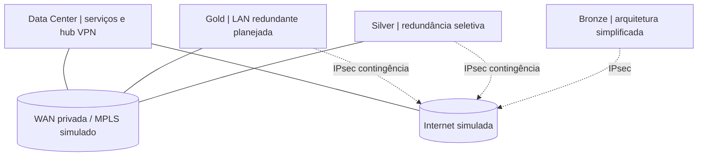

# Enterprise Networking | Portfólio pessoal de arquitetura e laboratórios

**Idiomas:** [Português](README.md) | [English](README.en.md)

Projeto pessoal de **Giovani Serra** dedicado ao design, à implementação gradual e à validação de uma infraestrutura corporativa multi-site em ambiente virtual. O objetivo é documentar **decisões de engenharia, configurações, tráfego, falhas, testes e evidências**, no estilo de um case de engenharia de redes, e não apenas reunir topologias.

> **Transparência de execução:** o HLD, o LLD e o inventário de exemplo estão documentados. O validador Python e seus testes unitários funcionam localmente; a execução do workflow remoto depende de verificação no GitHub. **Não há evidências publicadas de que a topologia corporativa, a VPN IPsec, o HA ou as políticas estejam operacionais.** Modelos de configuração são explicitamente marcados como não validados.


## Cenário de negócio

O case acadêmico original apresenta uma **cooperativa de crédito fictícia** com 30 agências e projeção de expansão para 70. O laboratório reproduz apenas quatro papéis representativos: **Data Center, Gold, Silver e Bronze**. Isso permite validar a arquitetura em escala reduzida antes de simular cenários adicionais.

| Domínio | Responsabilidade | Tecnologias no desenho | Situação |
| --- | --- | --- | --- |
| Data Center | Serviços, roteamento central e hub VPN | Core, FortiGate, DNS/DHCP, monitoramento | Planejado |
| Gold | Filial de alta criticidade | VLANs, L3, OSPF, HA e dupla WAN | Planejado |
| Silver | Filial de médio porte | L3, rotas estáticas e contingência | Planejado |
| Bronze | Filial enxuta | Switch, NGFW e acesso VPN | Planejado |

> **Legenda:** `planejado` = definido em documento; `em execução` = configuração/testes em andamento; `validado` = evidências de teste e configuração disponíveis. O desenho não representa implantação em produção.

## Arquitetura lógica



Os links representados são **caminhos propostos**, não adjacências ou túneis comprovados. OSPF, IPSec, controle de acesso e failover terão critérios independentes de validação.

## Laboratórios e documentação

| Entrega | Conteúdo | Link |
| --- | --- | --- |
| Case integrado | Escopo por site, requisitos e navegação | [Enterprise-1](Enterprise-1/README.MD) |
| High Level Design | Domínios, dependências e decisões | [HLD](Enterprise-1/HLD/README.MD) |
| Low Level Design | VLANs, endereçamento e roteamento | [LLD](Enterprise-1/LLD/README.MD) |
| Topologias | Gold, Silver, Silver+ e Bronze | [Galeria](Enterprise-1/Topology/README.MD) |
| **Laboratório M1: Gold LAN** | Escopo, diagrama, inventário, configurações-modelo, verificação e troubleshooting | [Abrir laboratório](Enterprise-1/labs/M1-GOLD-LAN/README.md) |
| Plano de implementação | Etapas, aceites, rollback e riscos | [Implementação](Enterprise-1/Implementation/README.MD) |
| Segurança | Controles planejados e matriz de testes | [Segurança](Enterprise-1/SECURITY.md) |
| Troubleshooting | Hipóteses, comandos e investigação | [Cenários](Enterprise-1/Troubleshooting/README.MD) |
| Evidências | Como registrar resultados observados | [Padrão](Enterprise-1/evidence/README.md) |
| Evolução | Marcos e definições de pronto | [Roadmap](Enterprise-1/ROADMAP.md) |

### Padrão de documentação de cada laboratório

Cada laboratório será publicado com **contexto, objetivos, topologia, ambiente e versões, tabela de endereçamento, configuração sanitizada, comandos de verificação, resultados esperados e observados, capturas/prints, troubleshooting, limitações e conclusão**. Resultados só serão classificados como validados após execução real.

## Ferramentas e tecnologias

- **Planejadas para as simulações:** EVE-NG, Cisco IOS/IOS-XE e switches virtuais, FortiGate, Windows/Linux e Wireshark. Modelos e versões serão registrados em cada laboratório após confirmação.
- **Protocolos e recursos em estudo:** VLAN, trunk 802.1Q, STP, roteamento L3, OSPF, HSRP, IPsec, NAT, ACL/políticas NGFW, syslog, SNMPv3 e automação Python.
- **Entregue no repositório:** inventário JSON sintético, validador e testes unitários Python. Isso não equivale a testes de conectividade.

### Executar as verificações locais

Requisito: **Python 3.10+** e biblioteca padrão, sem instalar pacotes adicionais.

```bash
python scripts/validate_inventory.py
python -m unittest discover -s tests -v
python scripts/render_inventory.py
```

[Inventário sintético](Enterprise-1/inventory/sites.json) | [Implementação e critérios de aceite](Enterprise-1/Implementation/README.MD) | [Política de segurança](Enterprise-1/SECURITY.md)

## Próxima implementação

O primeiro laboratório, **M1: segmentação LAN da filial Gold**, tem configurações-modelo para um switch de acesso, um switch L3 e hosts de teste. Ele permanece **não executado neste repositório**. O próximo passo é adaptar as interfaces às imagens reais, executar no EVE-NG e anexar saídas, evidências e análise de cada teste.

## Autoria e uso

**© 2026 Giovani Serra.** Este repositório é um **portfólio pessoal**, não um projeto colaborativo. **Não aceito contribuições externas, pull requests ou solicitações de desenvolvimento.** O conteúdo é público apenas para demonstração e consulta. Não há licença open source concedida aos arquivos de minha autoria. Direitos de produtos, imagens e materiais de terceiros permanecem com seus titulares. Consulte [Política do projeto](PERSONAL_PROJECT.md).

**Nota de segurança:** não versionar credenciais, PSKs, dados de produção, licenças ou saídas contendo informações sensíveis. Os documentos acadêmicos originais do PIF não acompanham este repositório.
